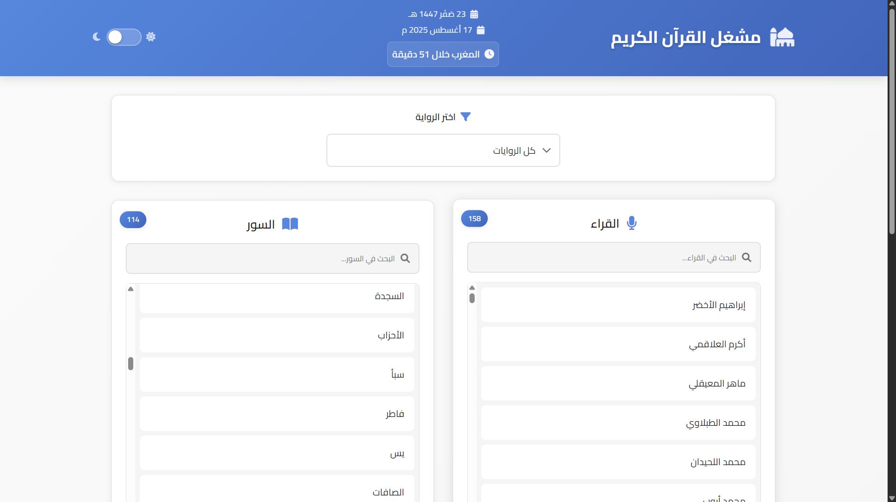
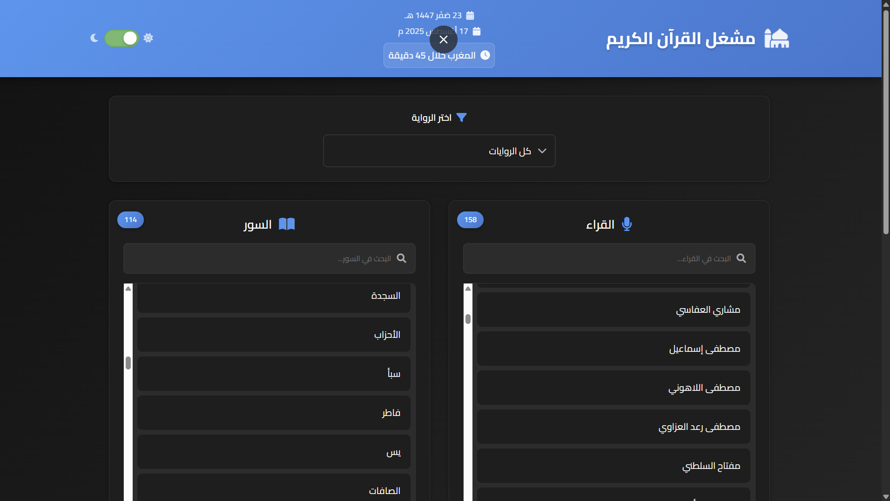
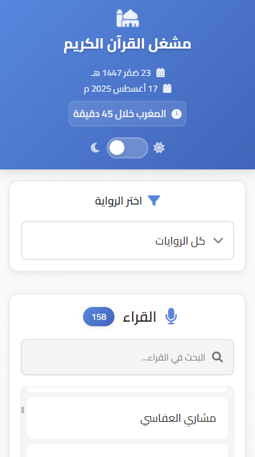
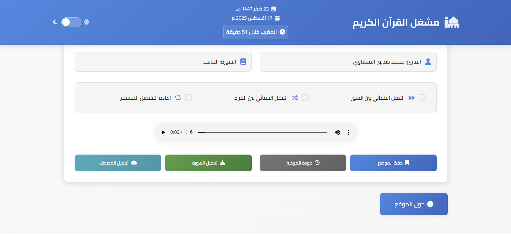

# 📖 The Reciters Library V0.4.1 | مكتبة القراء

<div align="center">


### A Modern Quran Listening Experience

**منصة إلكترونية للاستماع إلى القرآن الكريم بأصوات نخبة من أشهر القراء**

<br>

[](https://salah-eddine-program.github.io/The-Reciters-Library_V_0.4.1/)
[](https://github.com/salah-eddine-program/The-Reciters-Library_V_0.4)


</div>

---

## 🌙 About the Project | نبذة عن المشروع

**The Reciters Library** is a modern web application designed to provide an easy and comfortable experience for listening to the Holy Quran.

يهدف المشروع إلى توفير مكتبة قرآنية إلكترونية تتيح للمستخدمين الاستماع إلى القرآن الكريم بأصوات مجموعة من أشهر القراء، مع مجموعة من الأدوات والخصائص التي تجعل تجربة الاستخدام أكثر سهولة وراحة.

---

## ✨ Features | المميزات

### 🎙️ Reciters Library
- Access to more than 200 reciters.
- Multiple Quran narrations (Hafs, Warsh, Qaloon, and others).
- Search for reciters.
- Filter reciters by narration.
- Favorite reciters.

### 🎵 Audio Player
- Play and pause Quran recitations.
- Automatic transition between Surahs.
- Repeat Surahs or the complete Quran.
- Playback speed control.
- Sleep timer.
- Save playback position.
- Download individual Surahs.
- Download the complete Quran in compressed parts.

### 🌙 User Experience
- Dark mode and light mode.
- Responsive design for mobile, tablet, and desktop.
- Arabic interface.
- Keyboard shortcuts.
- Progressive Web App (PWA) support.

### 🕌 Islamic Information
- Hijri date.
- Prayer times.
- Location-based prayer information.

---

## 📸 Screenshots | صور من التطبيق

### 🖥️ User Interface | واجهة المستخدم

| Light Mode | Dark Mode |
|:---:|:---:|
|  |  |

### 📱 Responsive Design | التصميم المتجاوب

| Desktop View | Mobile View |
|:---:|:---:|
|  |  |

### 🎵 Application Screenshots | لقطات من التطبيق

| Home Page | Audio Player |
|:---:|:---:|
|  |  |

### ℹ️ About Page | صفحة حول الموقع

<div align="center">


</div>

---

## 🛠️ Technologies Used | التقنيات المستخدمة

| Technology | Purpose |
|---|---|
| HTML5 | Application structure |
| CSS3 | Styling and responsive design |
| JavaScript | Interactive functionality |
| mp3quran API | Reciters and Quran audio |
| AlAdhan API | Prayer times and Hijri date |
| JSZip | Compressed downloads |
| Axios | HTTP requests |
| Service Worker | Caching and PWA support |
| Local Storage | Saving user preferences |

---

## 📡 APIs & Data Sources

- 🎧 [mp3quran.net](https://mp3quran.net/) — Quran reciters and audio.
- 🕌 [AlAdhan API](https://aladhan.com/prayer-times-api) — Prayer times and Hijri calendar.

---

## ⌨️ Keyboard Shortcuts | اختصارات لوحة المفاتيح

| Key | Function |
|:---:|---|
| Space | Play / Pause |
| → | Forward 10 seconds |
| ← | Backward 10 seconds |
| ↑ | Increase volume |
| ↓ | Decrease volume |
| N | Next Surah |
| P | Previous Surah |
| Shift + N | Next Reciter |
| Shift + P | Previous Reciter |
| R | Toggle repeat |
| A | Toggle autoplay |

---

## 🚀 Live Demo | جرب التطبيق

<div align="center">

### Experience The Reciters Library

استمتع بتجربة الاستماع إلى القرآن الكريم مباشرة عبر الموقع.

[](https://salah-eddine-program.github.io/The-Reciters-Library_V_0.4.1/)

**Website:**  
https://salah-eddine-program.github.io/The-Reciters-Library_V_0.4.1/

</div>

---

## 📂 Project Structure | بنية المشروع

```text
The-Reciters-Library_V_0.4/
│
├── index.html
├── style.css
├── script.js
├── sw.js
├── manifest.json
├── reciter-photos.json
│
├── img1.png
├── img2.png
├── img3.png
├── img4.png
├── img5.png
│
├── icon-16.png
├── icon-32.png
├── icon-96.png
├── icon-192.png
├── icon-512.png
└── apple-touch-icon.png
```

---

## 📈 Version History | إصدارات المشروع

| Version | Description |
|---|---|
| V0.1 | Initial release |
| V0.2 | Feature improvements |
| V0.3 | Interface and functionality updates |
| V0.4 | Major development update |
| V0.4.1 | Latest published version |

---

## 🔮 Future Improvements | التطويرات المستقبلية

- Improve the audio player.
- Add more reciters and narrations.
- Improve search and navigation.
- Add more customization options.
- Continue improving mobile experience.

---

## 🤝 Contributing | المساهمة

Contributions, suggestions, and feedback are welcome.

إذا كانت لديك اقتراحات أو أفكار لتطوير المشروع، يمكنك فتح Issue في مستودع GitHub.

[GitHub Issues](https://github.com/salah-eddine-program/The-Reciters-Library_V_0.4/issues)

---

## 👨‍💻 Developer | المطور

<div align="center">

### Salah Eddine Benettouati

**Electronics Engineer | Embedded Systems**

[](https://github.com/salah-eddine-program)

</div>

---

## 📜 License

Please refer to the repository for licensing and usage conditions.

---

<div align="center">

### 🤲 دعاؤنا أن يكون هذا العمل صدقة جارية

**اللهم اجعل القرآن الكريم ربيع قلوبنا ونور صدورنا.**

Made with ❤️ for the Holy Quran.

⭐ If you like this project, consider giving it a star on GitHub.

</div>
