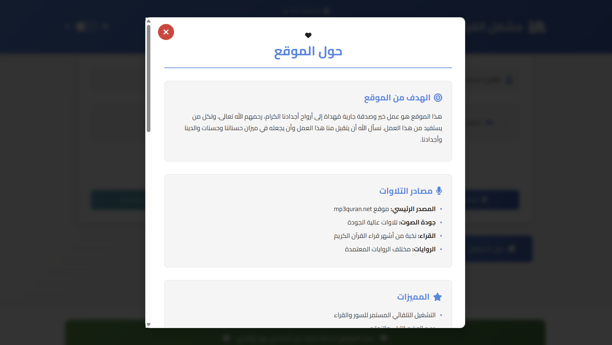

# The Noble Quran Player - مشغل القرآن الكريم 🕌

<div align="center">

**A modern and comprehensive web platform for listening to the Holy Quran with the voices of the most famous reciters**

[](https://salah-eddine-program.github.io/The-Reciters-Library_V_0.3/)
[]()
[]()
[]()

</div>

---

## 📖 نظرة عامة

**مشغل القرآن الكريم** هو تطبيق ويب إسلامي مبتكر وحديث، مُصمم خصيصاً لتوفير تجربة استماع مميزة للقرآن الكريم. يجمع التطبيق بين التصميم العصري والوظائف المتقدمة لخدمة المسلمين في جميع أنحاء العالم.

### 🎯 رسالتنا
> *"وَنُنَزِّلُ مِنَ الْقُرْآنِ مَا هُوَ شِفَاءٌ وَرَحْمَةٌ لِّلْمُؤْمِنِينَ"*

هذا المشروع صدقة جارية مُهداة إلى أرواح أجدادنا الكرام، رحمهم الله تعالى، وهدية لكل مسلم يسعى للتقرب إلى الله من خلال كتابه العزيز.

---

## ✨ المميزات الرئيسية

### 🎵 تجربة الاستماع
- **🔄 التشغيل التلقائي المتقدم**: انتقال سلس بين السور والقراء
- **🎛️ تحكم كامل**: إيقاف، تشغيل، تقديم، تأخير
- **🔁 أوضاع التكرار**: تكرار السورة أو المصحف كاملاً
- **⚡ تحميل فوري**: استجابة سريعة وتحميل ذكي
- **⭐ المفضلة**: نجمة على كل قارئ وسورة، والمفضلة تظهر أولاً
- **⏱️ مؤقّت النوم وسرعة التشغيل**: من 0.75× إلى 2×
- **📲 تطبيق قابل للتثبيت (PWA)**: أزرار شاشة القفل وعمل الواجهة بدون إنترنت

### 👥 مكتبة القراء
- **🌟 نخبة من أشهر القراء**: أكثر من 200 قارئ
- **📚 تنوع الروايات**: حفص، ورش، قالون، والمزيد
- **🔍 البحث الذكي**: البحث السريع في أسماء القراء
- **📊 فلترة متقدمة**: تصنيف حسب الرواية

### 📱 تصميم متجاوب
- **🌙 الوضع الليلي**: حماية للعينين أثناء الاستماع الليلي
- **☀️ الوضع النهاري**: واجهة مشرقة ومريحة
- **📱 متوافق مع جميع الأجهزة**: هاتف، تابلت، حاسوب
- **🎨 تصميم أنيق**: واجهة مستخدم حديثة وبديهية

### 🕐 المعلومات الإسلامية
- **📅 التاريخ الهجري**: عرض التاريخ الهجري بدقة
- **🕌 مواقيت الصلاة**: أوقات الصلاة للموقع الحالي
- **🌍 التوطين**: دعم كامل للغة العربية

### 💾 إدارة المحتوى
- **💾 حفظ الموضع**: استكمال الاستماع من حيث توقفت
- **⬇️ تحميل السور**: تحميل السور المفضلة للاستماع دون إنترنت
- **📦 تحميل المصحف كاملاً**: على أجزاء مضغوطة مع شريط تقدّم وإمكانية الإلغاء
- **🔖 الإشارات المرجعية**: حفظ واسترجاع المواضع المفضلة

---

## 🚀 العرض التوضيحي

### 🖥️ واجهة المستخدم

<div align="center">

| الوضع النهاري | الوضع الليلي |
|:---:|:---:|
|  |  |

</div>

### 📲 التجاوب على الأجهزة

<div align="center">

| 🖥️ سطح المكتب | 📱 الهاتف المحمول |
|:---:|:---:|
|  |  |

</div>

---

## 🛠️ التقنيات المستخدمة

### Frontend
```javascript
🌐 HTML5        // بنية الموقع
🎨 CSS3         // التصميم والتنسيق  
⚡ JavaScript   // الوظائف التفاعلية
📱 Responsive   // التصميم المتجاوب
```

### APIs & Services
```javascript
🎵 mp3quran.net API    // مصدر التلاوات
🕌 Aladhan API         // التاريخ الهجري ومواقيت الصلاة
📦 JSZip               // ضغط وتحميل الملفات
🌐 Axios               // طلبات HTTP
```

### Features
```javascript
🎯 Service Worker      // التخزين المؤقت
⌨️ Keyboard Shortcuts  // اختصارات المفاتيح
🔄 Auto-continuation   // التشغيل التلقائي
💾 Local Storage       // الحفظ المحلي
```

---

## 🖼️ صور القرّاء

لا يوفّر mp3quran صوراً للقرّاء، لذا تُضاف يدوياً:

1. ضع الصورة داخل مجلد `photos/` (مربعة، 256×256، بصيغة WebP أو JPG).
2. اكتب مسارها في `reciter-photos.json` مفتاحه رقم القارئ:

```json
{
  "1": "photos/ibrahim-alakdar.webp"
}
```

3. لمعرفة أرقام القرّاء افتح الموقع ثم Console (`F12`) واكتب `listReciters()`.

القارئ بلا صورة يظهر بحرفه الأول تلقائياً. استخدم صوراً تملك حق نشرها أو مرخّصة (مثل Wikimedia Commons) واذكر المصدر.

---

## ⌨️ اختصارات المفاتيح

| المفتاح | الوظيفة |
|:---:|:---|
| `مسافة` | ⏯️ تشغيل/إيقاف |
| `→` | ⏩ تقديم 10 ثواني |
| `←` | ⏪ تأخير 10 ثواني |
| `↑` | 🔊 رفع الصوت |
| `↓` | 🔉 خفض الصوت |
| `n` | ⏭️ السورة التالية |
| `p` | ⏮️ السورة السابقة |
| `N` | 👤 القارئ التالي |
| `P` | 👤 القارئ السابق |
| `r` | 🔁 تبديل وضع الإعادة |
| `a` | 🔄 تبديل التشغيل التلقائي |

---

## 🎨 لقطات الشاشة

<details>
<summary>🖼️ مشاهدة لقطات الشاشة</summary>

### الصفحة الرئيسية


### مشغل الصوت


### صفحة حول الموقع


</details>

---

## 📚 كيفية الاستخدام

### 🎵 تشغيل التلاوة
1. **اختر القارئ** من القائمة الجانبية
2. **حدد السورة** التي تريد الاستماع إليها
3. **اضغط على زر التشغيل** أو استخدم مسافة للتشغيل

### ⚙️ الإعدادات المتقدمة
- **التشغيل التلقائي**: تفعيل الانتقال التلقائي بين السور
- **وضع التكرار**: إعادة تشغيل مستمرة
- **الوضع الليلي**: للاستماع المريح في الليل

### 💾 التحميل والحفظ
- **حفظ الموضع**: لاستكمال الاستماع لاحقاً
- **تحميل السورة**: للاستماع دون إنترنت
- **تحميل المصحف**: تحميل مصحف كامل

---

## 🌟 المساهمة والتطوير

### 🤝 المساهمة
نرحب بمساهماتكم لتطوير هذا المشروع الخيري:

```bash
# استنساخ المشروع
git clone https://github.com/salah-eddine-program/The-Reciters-Library_V_0.3.git

# الدخول إلى المجلد
cd The-Reciters-Library_V_0.3

# فتح في المتصفح
open index.html
```

### 🎯 الخطط المستقبلية
- [ ] 📱 تطبيق الهاتف المحمول
- [ ] 🔍 البحث في نص القرآن
- [ ] 📊 إحصائيات الاستماع
- [ ] 🌍 دعم لغات متعددة
- [ ] 🎨 سمات إضافية
- [ ] 🤖 ذكاء اصطناعي للتوصيات

---

## 📞 التواصل والدعم

<div align="center">

### 🤲 دعواتكم هي أعظم مكافأة لنا

**اللهم تقبل منا هذا العمل واجعله صدقة جارية عن أرواح أجدادنا**

</div>

### 📧 للتواصل
- 💬 **المشاكل التقنية**: [GitHub Issues](https://github.com/salah-eddine-program/The-Reciters-Library_V_0.3/issues)
- 💡 **الاقتراحات**: نرحب بجميع الأفكار الإبداعية
- 🤝 **المساهمة**: ساهم في نشر الخير

---

## 📄 الترخيص والحقوق

```
🕌 مشغل القرآن الكريم
صدقة جارية عن أجدادي، وبرّ لوالديّ
جعل الله هذا العمل في ميزان حسناتنا وحسنات جميع المسلمين

جميع الحقوق محفوظة © 2025
```

### 📚 مصادر البيانات
- **🎵 التلاوات**: [mp3quran.net](https://www.mp3quran.net)
- **🕌 أوقات الصلاة**: [Aladhan API](https://aladhan.com/prayer-times-api)
- **🎨 الأيقونات**: [FontAwesome](https://fontawesome.com)
- **📝 الخطوط**: [Google Fonts - Cairo](https://fonts.google.com/specimen/Cairo)

---

<div align="center">

### 🌟 إذا أعجبك المشروع، لا تنس إعطاؤه نجمة ⭐

**"خير الناس أنفعهم للناس"**

[](https://github.com/salah-eddine-program/The-Reciters-Library_V_0.3/stargazers)
[](https://github.com/salah-eddine-program/The-Reciters-Library_V_0.3/network/members)

### 🤲 ادعُ لنا بالخير والبركة

</div>

---
<div align="center">

</div>


