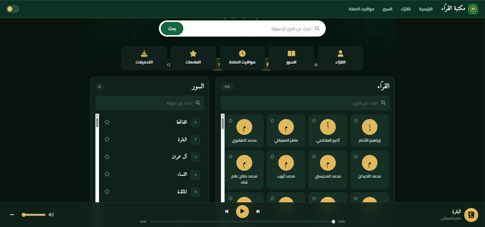

# 📖 The Reciters Library V0.4.1

<div align="center">

  

  <p>
    **مكتبة قرآنية إلكترونية للاستماع إلى القرآن الكريم**
    <br>
    A modern web application for listening to the Holy Quran.
  </p>

  <p>
    <a href="https://salah-eddine-program.github.io/The-Reciters-Library_V_0.4.1/">
      
    </a>
    <a href="https://github.com/salah-eddine-program/The-Reciters-Library_V_0.4">
      
    </a>
  </p>

  
  
  
  

</div>

---

## 🌙 نبذة عن المشروع | About

**The Reciters Library** هو تطبيق ويب يهدف إلى توفير تجربة سهلة ومريحة للاستماع إلى القرآن الكريم، من خلال مكتبة تضم مجموعة من القراء والروايات والسور القرآنية.

تم تطوير المشروع باستخدام تقنيات الويب الحديثة، مع التركيز على سهولة الاستخدام، وسرعة الوصول إلى المحتوى، والتوافق مع مختلف الأجهزة.

**The Reciters Library** is a web application designed to provide a simple and comfortable Quran listening experience, offering access to Quran reciters, narrations, and Surahs.

---

## ✨ المميزات | Features

- 📖 تصفح سور القرآن الكريم.
- 🎙️ مكتبة متنوعة من القراء.
- 🔍 البحث عن القراء والسور.
- 📚 تصفية القراء حسب الرواية.
- ▶️ مشغل صوتي للاستماع إلى التلاوات.
- ⏭️ الانتقال التلقائي إلى السورة التالية.
- 🔁 إمكانية تكرار التشغيل.
- ⭐ حفظ القراء والسور المفضلة.
- ⬇️ إمكانية تحميل التلاوات.
- 🌙 الوضع الليلي والوضع النهاري.
- 🕌 عرض مواقيت الصلاة.
- 📅 عرض التاريخ الهجري والميلادي.
- ⏱️ مؤقت إيقاف التشغيل.
- 📱 تصميم متجاوب مع الهواتف والأجهزة اللوحية والحواسيب.
- 📲 دعم خصائص تطبيقات الويب التقدمية (PWA).

---

## 🛠️ Technologies Used

| Technology | Description |
|---|---|
| HTML5 | Application structure |
| CSS3 | Styling and responsive design |
| JavaScript | Application logic and interactions |
| mp3quran API | Quran reciters and audio content |
| AlAdhan API | Prayer times and date information |
| PWA | Progressive Web App support |
| GitHub Pages | Website hosting |

---

## 📸 Screenshots

أضف صوراً حقيقية من موقعك داخل مجلد `screenshots`، ثم استعمل المسارات التالية بعد التأكد من أسماء الصور:

| Home Page | Audio Player |
|---|---|
| `screenshots/home.png` | `screenshots/player.png` |

مثال لإظهار الصور:

```markdown


```

---

## 🌐 Live Demo

يمكنك تجربة التطبيق مباشرة من خلال الرابط:

<div align="center">

### [🚀 Open The Reciters Library V0.4.1](https://salah-eddine-program.github.io/The-Reciters-Library_V_0.4.1/)

</div>

---

## 📡 APIs & Data Sources

يعتمد المشروع على مصادر خارجية لتوفير بعض البيانات والخدمات:

- **[mp3quran API](https://mp3quran.net/)** — بيانات القراء والسور والتلاوات الصوتية.
- **[AlAdhan API](https://aladhan.com/prayer-times-api)** — مواقيت الصلاة والتواريخ الهجرية.

---

## 📂 Project Structure

مثال توضيحي لتنظيم ملفات المشروع، ويجب تعديله ليتوافق مع بنية المستودع الفعلية:

```text
The-Reciters-Library_V_0.4.1/
│
├── index.html
├── README.md
│
├── css/
│   └── style.css
│
├── js/
│   └── script.js
│
├── assets/
│   ├── images/
│   ├── icons/
│   └── fonts/
│
├── screenshots/
│   ├── home.png
│   └── player.png
│
└── manifest.json
```

---

## 🚀 Version History

| Version | Description |
|---|---|
| V0.1 | Initial project release |
| V0.2 | Improvements and additional features |
| V0.3 | Interface and functionality improvements |
| V0.4 | Major project update |
| V0.4.1 | Further improvements and refinements |

---

## 🔮 Future Improvements

- إضافة المزيد من القراء والروايات.
- تحسين تجربة البحث والتصفح.
- تطوير مشغل الصوت.
- إضافة المزيد من خيارات تخصيص التطبيق.
- تحسين الأداء والتوافق مع مختلف الأجهزة.
- مواصلة تطوير الواجهة وتجربة المستخدم.

---

## 🤝 Contributing

المشروع قابل للتطوير والتحسين.

إذا كانت لديك أفكار أو اقتراحات أو اكتشفت مشكلة، يمكنك فتح **Issue** في GitHub للمساهمة في تحسين المشروع.

---

## 👨‍💻 Developer

<div align="center">

### Salah Eddine Benettouati

**Electronics Engineer | Embedded Systems Enthusiast**

<a href="https://github.com/salah-eddine-program">
  
</a>

</div>

---

## 📜 License

لم يتم تحديد ترخيص رسمي للمشروع بعد. يرجى مراجعة المستودع لمعرفة شروط الاستخدام وإعادة التوزيع.

---

<div align="center">

**اللهم اجعل القرآن الكريم ربيع قلوبنا ونور صدورنا.**

Made with ❤️ for the Holy Quran.

⭐ إذا أعجبك المشروع، لا تنسَ وضع نجمة للمستودع على GitHub.

</div>
